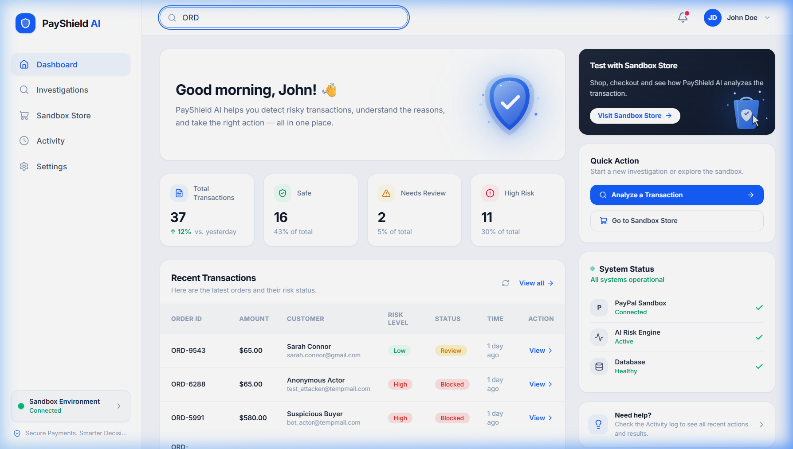
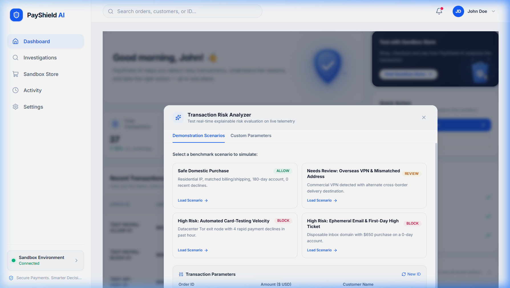
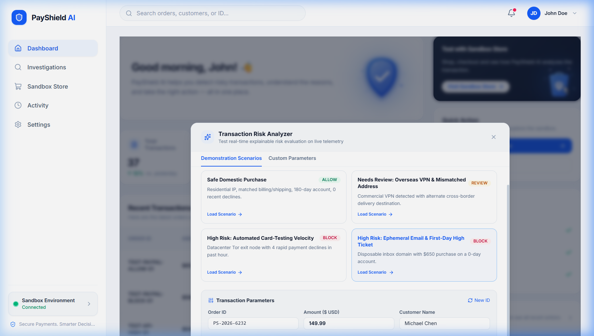
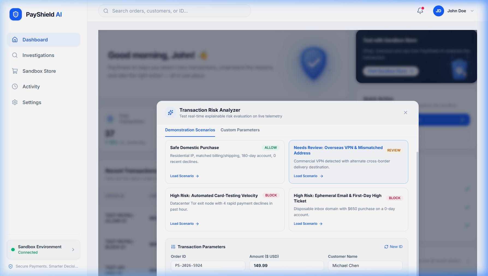
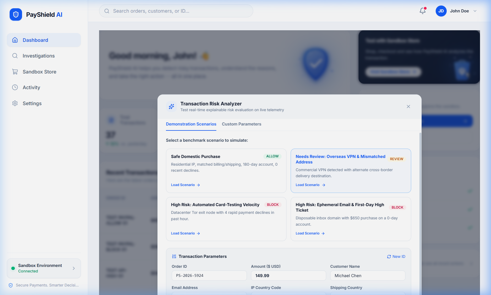

# 🛡️ PayShield AI — Pre-Capture Payment Security Agent

> **An evidence-based payment security firewall and explainable AI risk interceptor for online merchants.**  
> Built for the **PayPal AI Hackathon 2026** • Zero-Cost Cloud Deployment • Fully Reproducible $0 Local Run.

[](https://payshield-ai-ctkr.onrender.com)
[](https://developer.paypal.com)
[](https://www.ag-grid.com)
[](./LICENSE)
[](./docs/TESTING.md)

---

## 🌐 Live Deployed Application

- **Public Cloud URL:** [https://payshield-ai-ctkr.onrender.com](https://payshield-ai-ctkr.onrender.com)
- **Deployment Platform:** Render Free Tier (Node.js Full-Stack Service with unified static asset serving)
- **API Health Check:** [https://payshield-ai-ctkr.onrender.com/api/health](https://payshield-ai-ctkr.onrender.com/api/health)

> *Note on Free Tier Sleep:* Render free instances spin down after 15 minutes of inactivity. If the service is sleeping, the first request may take ~30–50 seconds to spin up. Once awake, requests respond with sub-second latency.

---

## 📋 Table of Contents
- [The Problem PayShield AI Addresses](#-the-problem-payshield-ai-addresses)
- [How PayShield AI Works](#-how-payshield-ai-works)
- [Feature Matrix (Implemented vs. Planned)](#-feature-matrix-implemented-vs-planned)
- [System Architecture](#-system-architecture)
- [Application Screenshots](#-application-screenshots)
- [Technology Stack](#-technology-stack)
- [Prerequisites & Local Installation](#-prerequisites--local-installation)
- [Environment Configuration (.env.example)](#-environment-configuration-envexample)
- [Database Setup & Seeding](#-database-setup--seeding)
- [Running the Application](#-running-the-application)
- [PayPal Sandbox Setup](#-paypal-sandbox-setup)
- [Testing & Quality Verification](#-testing--quality-verification)
- [Known Limitations](#-known-limitations)
- [Security & Privacy Guarantees](#-security--privacy-guarantees)
- [Detailed Documentation](#-detailed-documentation)
- [License](#-license)

---

## 💥 The Problem PayShield AI Addresses

E-commerce merchants lose tens of billions annually to payment fraud, card-testing bot attacks, and dispute settlement penalties. Traditional fraud solutions present two catastrophic flaws:

1. **Post-Authorization Failure:** They score transactions *after* the gateway authorization call. Even if a fraud alert is triggered, the merchant is already liable for payment gateway processing fees and dispute penalties.
2. **Opaque "Black Box" Decisions:** Conventional machine learning scoring tools output arbitrary numbers (e.g. `Score: 84`) without explainability. Fraud analysts cannot distinguish between an observed technical fact (e.g. proxy IP) and a heuristic inference, forcing merchants to either blindly absorb chargebacks or alienate legitimate buyers through unexplained declines.

**PayShield AI transforms this paradigm by acting as an intelligent, explainable pre-capture firewall.**

---

## 🧠 How PayShield AI Works

```mermaid
sequenceDiagram
    autonumber
    actor Shopper as Customer / Browser
    participant Store as Frontend (React 19)
    participant Server as PayShield Backend (Express)
    participant Engine as AI Risk & Explainability Engine
    participant PayPal as PayPal Sandbox API
    participant DB as SQLite (payshield.db)

    Shopper->>Store: Submits Checkout Order
    Store->>Server: POST /api/paypal/create-order (Order & Telemetry)
    Server->>Engine: Run Dual-Model Risk Pipeline
    
    rect rgb(20, 25, 45)
    Note over Engine: 1. Deterministic Heuristic Rules (5 Categories)<br/>2. Calibrated ML Ensemble (Fraud Probability)<br/>3. Fact vs. Inference Attribution<br/>4. Counterfactual Generator ("What Would Change This?")
    end

    alt Risk Tier == BLOCK (Score > 65)
        Engine-->>Server: Result: BLOCK (High Risk)
        Server->>DB: Log Intercepted Transaction & Audit Record
        Server-->>Store: HTTP 403 Forbidden (Pre-Capture Arrest)
        Note over Server,PayPal: 🛑 Zero Gateway Request Sent to PayPal
        Store-->>Shopper: Order Blocked with Explanation & Remediation Path
    else Risk Tier == ALLOW or Approved REVIEW (Score <= 65)
        Engine-->>Server: Result: ALLOW / REVIEW
        Server->>PayPal: POST /v2/checkout/orders (Bearer Token Cached)
        PayPal-->>Server: 201 Created (PayPal Order ID)
        Server->>DB: Save Transaction & Risk Assessment
        Server-->>Store: Returns Approval & PayPal Order ID
        Store->>Shopper: Displays PayPal Checkout Button
        Shopper->>PayPal: Authorizes Payment
        Store->>Server: POST /api/paypal/capture-order
        Server->>PayPal: POST /v2/checkout/orders/{id}/capture
        PayPal-->>Server: 200 OK (Capture ID)
        Server->>DB: Update Payment Status & Append Audit Trail
        Server-->>Store: Order Confirmed
    end
```



---

## ✨ Feature Matrix (Implemented vs. Planned)

To maintain absolute transparency, here is the exact breakdown of implemented features versus planned future roadmap enhancements:

### Fully Implemented Features (Verified in Active Codebase)
- [x] **Pre-Capture Interception Firewall:** Halts adversarial orders before creating or capturing PayPal orders (`POST /api/paypal/create-order`).
- [x] **Dual-Model Risk Engine:** Deterministic rule engine across 5 categories + calibrated in-process logistic regression ML classifier.
- [x] **Evidence-to-Action Forensics:** Explicitly tags and separates *Observed Telemetry Facts* from *Heuristic Model Inferences*.
- [x] **Actionable Counterfactuals:** Generates mathematical point reductions answering *"What Would Change This Decision?"* (e.g. 3D-Secure challenge: -30 pts).
- [x] **High-Throughput AG Grid Feed:** Custom-styled dark navy AG Grid Community table with risk tier badges, multi-column sorting, customer search, and interactive row drill-down.
- [x] **Official PayPal Orders v2 Integration:** Real OAuth2 Bearer token caching, Order creation, and pre-authorized Capture with double-capture lock.
- [x] **Built-In Offline Mock Sandbox Mode:** Complete zero-dependency fallback that simulates PayPal IDs without external network calls.
- [x] **Interactive Sandbox Storefront:** Live checkout simulator loaded with 5 distinct test archetypes (Clean Shopper, Anonymous VPN, Card-Testing Attack, Young Account, Loyal Customer).
- [x] **Tamper-Evident SQLite Audit Ledger:** Immutable event logs with actor attribution (`SYSTEM_AGENT` vs `MERCHANT_ANALYST`), timestamps, and JSON diffs.
- [x] **APIMatic Contract Validator:** In-app inspection suite verifying PayPal v2 payloads against APIMatic schemas.
- [x] **Forensic Report Modal:** Printable, formatted PDF-style investigation report with executive summaries.
- [x] **Dual-Mode Role Governance & 1-Click Hackathon Switcher:** Instant toggling between **Demo Evaluator** (zero-friction evaluation) and **Merchant Administrator** (privileged decision overrides) with dataset distinction badges (`[Demo]` vs `[Live]`).
- [x] **Zero-Cost Render Blueprint:** Single-command cloud deployment via [`render.yaml`](./render.yaml).

### Planned Roadmap Features (Future Scope)
- [ ] **Automated Biometric Telemetry:** Keystroke cadence and mouse cursor entropy scoring.
- [ ] **WebHook Ingestion Engine:** Live listening for PayPal disputes and chargeback webhooks (`PAYMENT.CAPTURE.DENIED`).
- [ ] **Consensus Multi-Merchant Graph:** Distributed IP reputation sharing across multiple participating merchants.

---

## 🏗️ System Architecture

PayShield AI is organized as a unified full-stack application:

```text
┌────────────────────────────────────────────────────────────────────────┐
│                        Shopper / Merchant Browser                      │
│                                                                        │
│   [ React 19 + TypeScript + Tailwind CSS v4 + AG Grid Community ]      │
│   ├── /                 ── Real-time security metrics & triage feed    │
│   ├── /investigation    ── 4-section evidence & counterfactual review  │
│   ├── /checkout         ── Interactive Sandbox Storefront              │
│   ├── /audit            ── Tamper-evident SQLite audit trail           │
│   └── /settings         ── Gateway health & APIMatic schema validator  │
└────────────────────────────────────┬───────────────────────────────────┘
                                     │ HTTP REST (/api/...)
                                     ▼
┌────────────────────────────────────────────────────────────────────────┐
│                    Express + TypeScript Server                         │
│                                                                        │
│   ├── /api/orders       ── Order evaluation & manual overrides         │
│   ├── /api/paypal       ── Pre-capture verification, create & capture  │
│   ├── /api/audit        ── Tamper-evident audit log querying           │
│   └── /api/health       ── System vitals & policy version metadata     │
│                                                                        │
│   ┌─────────────────────┐  ┌──────────────────────┐  ┌──────────────┐  │
│   │ Heuristic Engine    │  │ Calibrated Classifier│  │ PayPalClient │  │
│   │ (rules.ts)          │  │ (classifier.ts)      │  │ (OAuth2 SDK) │  │
│   └─────────────────────┘  └──────────────────────┘  └──────────────┘  │
│                                                                        │
│   ┌──────────────────────────────────────────────────────────────────┐ │
│   │ SQLite Database (payshield.db — WAL mode, foreign keys enforced) │ │
│   └──────────────────────────────────────────────────────────────────┘ │
└────────────────────────────────────┬───────────────────────────────────┘
                                     │ HTTPS
                                     ▼
┌────────────────────────────────────────────────────────────────────────┐
│       PayPal Sandbox API Gateway (https://api-m.sandbox.paypal.com)    │
│       ├── POST /v1/oauth2/token (Cached OAuth2 Bearer Tokens)          │
│       ├── POST /v2/checkout/orders                                     │
│       └── POST /v2/checkout/orders/{id}/capture                        │
└────────────────────────────────────────────────────────────────────────┘
```

For full architectural diagrams and data flows, see [docs/ARCHITECTURE.md](./docs/ARCHITECTURE.md).

---

## 📸 Application Screenshots

The screenshots below are **genuine captures from the live running application**:

### 1. Merchant Security Command Center (Dashboard)
High-level security KPIs, security health donut, and the live AG Grid triage feed:


### 2. Forensic Investigation & Evidence Unbundling
4-pillar forensic workbench displaying observed facts, inferences, and factor weights:


### 3. Actionable Counterfactual Reasoning ("What Would Change This Decision?")
Transparent conditions and point reductions that would safely unlock the transaction:


### 4. Printable Investigation Report
Clean, structured forensic investigation report ready for merchant compliance:


### 5. Interactive Sandbox Storefront
Simulate 5 risk archetypes with pre-capture evaluation and PayPal Sandbox checkout:


### 6. Tamper-Evident SQLite Audit Ledger
Immutable history of risk decisions, policy versions, and analyst overrides:


### 7. Gateway Settings & APIMatic Contract Validator
Gateway connection diagnostics and canonical PayPal Orders v2 contract schema inspector:


---

## 💻 Technology Stack

| Domain | Technology | Purpose |
| :--- | :--- | :--- |
| **Frontend Framework** | **React 19** & **TypeScript** | Component-driven reactive user interface |
| **Bundler & Tooling** | **Vite 8** | Rapid development server & optimized production bundling |
| **Styling & Design** | **Tailwind CSS v4** (`@tailwindcss/vite`) | Custom fintech dark navy design system |
| **Data Grid** | **AG Grid Community v36** | High-performance transaction triage feed with custom cells |
| **Icons** | **Lucide React** | Consistent fintech iconography |
| **Backend Runtime** | **Node.js (v18+)** (ES Modules) | Server execution environment |
| **API Framework** | **Express 4** & **TypeScript** | REST API endpoints & static client delivery |
| **Database** | **SQLite (better-sqlite3)** | Embedded local persistence with WAL mode |
| **Validation** | **Zod** | Runtime schema validation for transactions and PayPal contracts |
| **Payment Gateway** | **PayPal Orders v2 REST API** | Official sandbox OAuth2 authentication and capture |
| **Test Runner** | **Vitest 3** | In-process unit and integration test runner (11 tests) |
| **Linter** | **Oxlint** | High-speed JavaScript and TypeScript linting |

---

## 📦 Prerequisites & Local Installation

### Prerequisites
- **Node.js**: `v18.0.0` or higher (`v20.x` or `v22.x` recommended)
- **npm**: `v9.0.0` or higher
- **Git**

### Installation Steps
```bash
# 1. Clone the repository
git clone https://github.com/harsha-dev78/Payshield-AI.git
cd Payshield-AI

# 2. Install root, backend, and frontend dependencies
npm install
npm install --prefix server
npm install --prefix client
```

For complete setup instructions, see [docs/SETUP.md](./docs/SETUP.md).

---

## ⚙️ Environment Configuration (`.env.example`)

Copy the environment template before running:
```bash
# On Linux / macOS / Git Bash:
cp .env.example server/.env

# On Windows PowerShell:
Copy-Item .env.example server/.env
```

Contents of [`.env.example`](./.env.example):
```env
# Server Network Configuration
PORT=5000
NODE_ENV=development

# PayPal Sandbox API Credentials (Optional - works offline if omitted)
PAYPAL_CLIENT_ID=your_paypal_sandbox_client_id_here
PAYPAL_CLIENT_SECRET=your_paypal_sandbox_client_secret_here
PAYPAL_API_BASE=https://api-m.sandbox.paypal.com

# Explainable Risk Engine Policy Thresholds
RISK_THRESHOLD_ALLOW=30
RISK_THRESHOLD_REVIEW=65
```

---

## 🗄️ Database Setup & Seeding

PayShield AI uses an embedded SQLite database ([`payshield.db`](./server/payshield.db)) running in **WAL (Write-Ahead Logging)** mode with enforced foreign keys:

- **Automatic Table Initialization:** Database tables (`transactions`, `risk_assessments`, `audit_logs`) and indexes are automatically created on initial startup via embedded schema definitions in [`database.ts`](./server/src/db/database.ts).
- **Synthetic Benchmark Seeds:** On first boot, [`seeds.ts`](./server/src/db/seeds.ts) automatically seeds 8 realistic benchmark transactions across benign, card-testing, and VPN personas.
- **Zero Database Server Setup:** No PostgreSQL, MySQL, or Docker daemon required.

---

## 🚀 Running the Application

### Option A: Run Concurrently (Recommended)
From the project root:
```bash
npm run dev
```
- **Frontend Dashboard:** [http://localhost:5173](http://localhost:5173)
- **Backend API:** [http://localhost:5000/api](http://localhost:5000/api)

### Option B: Run Services Individually
```bash
# Terminal 1: Backend Server (Port 5000)
npm run dev:server

# Terminal 2: Frontend Client (Port 5173)
npm run dev:client
```

---

## 🔑 PayPal Sandbox Setup

### Live Sandbox Mode
1. Sign in to the [PayPal Developer Dashboard](https://developer.paypal.com/dashboard/).
2. Navigate to **Apps & Credentials** → **Sandbox**.
3. Create an app (e.g. `PayShield-App`) and copy your **Client ID** and **Client Secret**.
4. Paste these into `server/.env`.
5. Restart `npm run dev`. The `/settings` page will indicate `LIVE_SANDBOX`.

### Zero-Config Offline Mock Mode
If you leave the default placeholders in `server/.env`, PayShield AI **automatically activates its built-in offline simulator**:
- Simulated orders return synthetic PayPal order IDs (`PAYPAL-SANDBOX-XXXXX`).
- Captures return mock transaction IDs (`CAP-XXXXX`).
- Zero calls are made to external PayPal servers, ensuring a 100% reliable offline demo experience.

---

## 🧪 Testing & Quality Verification

PayShield AI includes an automated Vitest test suite covering risk rules, gateway interception, and tamper-evident auditing:

```bash
# Run the 11 automated test cases:
npm test

# Run frontend linter:
npm run lint --prefix client

# Run production build:
npm run build
```

### Automated Test Coverage (11/11 Passing)
- `tests/riskEngine.test.ts` (3 tests) — Heuristic attribution, baseline scoring, and counterfactual point reductions.
- `tests/investigationAndSecurity.test.ts` (5 tests) — Transaction retrieval, fact vs. inference tagging, manual override audit logs, and SQL injection safety.
- `tests/paypalAndApiWorkflows.test.ts` (3 tests) — Pre-capture high-risk blocking, mock order creation, and capture idempotency locks.

For the full test specification, see [docs/TESTING.md](./docs/TESTING.md).

---

## ⚠️ Known Limitations

1. **Local SQLite File Storage on Render Free Tier:**
   Render's free tier uses an ephemeral filesystem. If the container restarts or rebuilds, synthetic transactions reset to the seed baseline. For production deployments with long-term retention, an external database (e.g. Turso / PostgreSQL) or Render persistent disk is recommended.
2. **In-Memory Rate Limiting:**
   Velocity spike detection currently measures rapid failed transactions within the local database. Cross-region distributed velocity tracking across multiple server nodes is planned for v2.0.
3. **Simulated Telemetry in Sandbox:**
   Because browser sandbox test environments do not have real hardware GPS sensors, IP geolocations and VPN flags are simulated from the test personas during storefront checkout.

---

## 🔒 Security & Privacy Guarantees

- **PCI-DSS Scope Reduction:** Zero credit card numbers, CVVs, or expiration dates are collected, logged, or stored by PayShield servers.
- **Server-Side Secret Isolation:** PayPal Client Secret and OAuth2 Bearer tokens reside strictly in the server environment and are never transmitted to client browsers.
- **SQL Injection Defense:** All SQLite queries use strict parameterized bindings via `better-sqlite3`.
- **Pre-Capture Interception:** High-risk transactions are halted before payment authorization, stopping chargebacks before they happen.
- **Ethical AI Baseline:** Risk scoring evaluates technical and behavioral anomalies (proxy hops, velocity bursts, disposable domains), never demographic profiling.

For detailed security policies, see [docs/SECURITY.md](./docs/SECURITY.md).

---

## 📚 Detailed Documentation

- 📐 **[System Architecture](docs/ARCHITECTURE.md)** — In-depth architectural diagrams, component boundaries, and pipeline specifications.
- 🛠️ **[Setup & Installation Guide](docs/SETUP.md)** — Comprehensive local environment and cloud deployment walkthrough.
- 🧪 **[Testing & Quality Guide](docs/TESTING.md)** — Vitest specifications, test cases, and quality verification standards.
- 🔒 **[Security & Privacy Policy](docs/SECURITY.md)** — Defense-in-depth posture, PCI-DSS compliance, and responsible disclosure.

---

## 📄 License

This project is licensed under the **[MIT License](./LICENSE)**. Built with pride for the **PayPal AI Hackathon 2026**.
