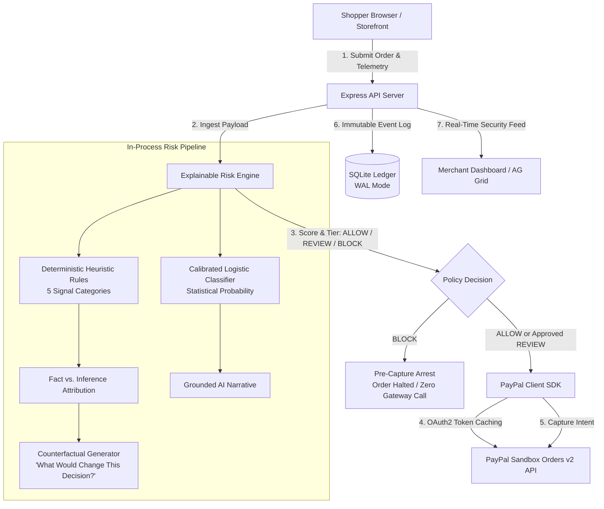

# System Architecture — PayShield AI

> **Technical Architecture Specification**  
> Built for the **PayPal AI Hackathon 2026** • Zero-Cost ($0) Full-Stack Deployment

---

## 1. High-Level System Overview

PayShield AI operates as an in-process, explainable pre-capture security firewall. It intercepts e-commerce transactions **before** payment capture or authorization, evaluating both client-side telemetry and transactional metadata to eliminate chargeback liability and card-testing attacks.

---

## 2. Directory & Component Boundaries

The project is structured as a coordinated full-stack monorepo:

| Directory | Core Technologies | Primary Responsibility |
| :--- | :--- | :--- |
| **`client/`** | React 19, Vite, Tailwind CSS v4, AG Grid Community, Lucide React | Presentation layer, high-throughput triage feed, forensic investigation workspace, and checkout simulator. |
| **`server/`** | Node.js (ESM), Express 4, TypeScript, better-sqlite3, Zod | API routing, risk scoring pipeline, SQLite persistence, PayPal Sandbox gateway, and production static asset serving. |
| **`docs/`** | Markdown specifications & genuine screenshots | Technical architecture, setup, testing, and security documentation. |
| **`.mcp/`** | APIMatic schema definitions | Machine-readable contract definitions for PayPal Orders v2 integration. |

---

## 3. Frontend Architecture (`client/`)

### 3.1. Design System & Theming
- Built with **Tailwind CSS v4** using the modern `@tailwindcss/vite` plugin.
- Dark navy fintech aesthetic configured with custom semantic tokens:
  - Backgrounds: Dark slate `#0a0f1d` to deep navy `#0f172a`.
  - Cards & Glass Surfaces: `#1e293b` with subtle borders (`#334155`).
  - Risk Badges:
    - `ALLOW`: Emerald green (`#10b981`)
    - `REVIEW`: Amber warning (`#f59e0b`)
    - `BLOCK`: Crimson red (`#ef4444`)

### 3.2. AG Grid Community Integration
- The live triage feed in [`Dashboard.tsx`](../client/src/pages/Dashboard.tsx) uses **AG Grid Community Edition** (`ag-grid-react` v36).
- Configured with custom cell renderers for risk badges, currency formatting, and quick-action drill-down.
- Built-in multi-column sorting, customer search filtering, and responsive container resizing.

### 3.3. Key Application Views
1. **Dashboard (`/`)**: Overview security health donut meter, 4 KPI cards (Total Analyzed, Intercepted Attacks, Fraud Rate, Avg Latency), and the live AG Grid triage table.
2. **Investigation (`/investigation`)**: Deep-dive forensic workbench showing:
   - *Telemetry Facts vs. Inferences* side-by-side cards.
   - *Factor Impact Waterfall* breaking down positive and negative risk weights.
   - *Actionable Counterfactual Box* showing mathematical point reduction conditions.
   - *Investigation Report Modal* providing a clean, printable PDF-style summary.
3. **Sandbox Storefront (`/checkout`)**: Interactive customer checkout simulation loaded with 5 distinct risk personas to demonstrate live pre-capture intervention.
4. **Audit Trail (`/audit`)**: Immutable log table displaying timestamped events, policy versions, and JSON diffs.
5. **Settings (`/settings`)**: PayPal Sandbox connection diagnostic, threshold policy sliders, and APIMatic contract validator.

---

## 4. Backend Architecture (`server/`)

### 4.1. Server Pipeline & Dual-Mode Serving
- Implemented in [`server/src/server.ts`](../server/src/server.ts).
- Middleware order:
  1. `cors()` for cross-origin local development.
  2. `express.json()` for structured JSON request parsing.
  3. Custom request duration and audit logging middleware.
  4. API router mounting (`/api/orders`, `/api/paypal`, `/api/audit`, `/api/health`).
  5. **Static File Serving & SPA Fallback**: Automatically checks for compiled frontend assets in `client/dist`. In production (e.g. on Render), the Express server directly serves static files and routes all non-API paths to `client/dist/index.html`.

### 4.2. Database & Persistence Layer (`better-sqlite3`)
- SQLite database stored at [`payshield.db`](../server/payshield.db).
- Configured with robust production pragmas:
  - `journal_mode = WAL` (Write-Ahead Logging) for non-blocking concurrent reads and writes.
  - `foreign_keys = ON` to enforce relational integrity between transactions and assessments.
- **Embedded DDL Schema Strategy**: Schema definitions are embedded directly in [`server/src/db/database.ts`](../server/src/db/database.ts) with candidate disk checks, preventing filesystem resolution failures during cloud container deployments.

---

## 5. AI Risk Engine & Explainability Pipeline

The risk engine runs in-process with sub-millisecond execution time:

### 5.1. Deterministic Heuristic Engine ([`rules.ts`](../server/src/engine/rules.ts))
Evaluates five orthogonal signal categories:
- **Geography**: Mismatches between IP geolocation, billing address, and shipping address.
- **Network**: Detection of datacenters, commercial VPNs, and Tor exit nodes.
- **Velocity**: Detection of rapid successive transaction attempts and prior failed authorizations (card-testing pattern).
- **Behavioral**: Detection of disposable/temporary email domains and unusual cart composition.
- **Financial**: High-value basket anomalies relative to account tenure and history.
- **Trust Offsets**: Reductions for established accounts (>90 days tenure) and domestic routing harmony.

### 5.2. Statistical ML Ensemble ([`classifier.ts`](../server/src/engine/classifier.ts))
- Runs an in-process calibrated logistic regression model.
- Converts normalized feature weights through a sigmoid activation function to output a continuous probability score (`0.00` to `1.00`).
- Generates a grounded, natural-language executive narrative detailing the primary anomaly.

### 5.3. Counterfactual Generator ([`explainability.ts`](../server/src/engine/explainability.ts))
- Rather than issuing a permanent refusal, the engine calculates *"What Would Change This Decision?"*.
- Identifies specific, achievable remediation paths (e.g. 3D-Secure challenge, customer phone verification, or residential IP checkout) with quantified point reductions.

---

## 6. PayPal Sandbox Integration ([`paypalClient.ts`](../server/src/services/paypalClient.ts))

- Uses official PayPal Orders v2 REST endpoints:
  - `POST /v1/oauth2/token` for Bearer token acquisition.
  - `POST /v2/checkout/orders` with `intent: 'CAPTURE'`.
  - `POST /v2/checkout/orders/{id}/capture` to finalize payment.
- **In-Memory OAuth2 Token Caching**: Tokens are cached in-memory and automatically refreshed 60 seconds prior to expiration, avoiding redundant authentication roundtrips.
- **Pre-Capture Safety Enforcement**: Transactions marked `BLOCK` by the risk engine are intercepted before the PayPal order creation endpoint can execute.
- **Offline Mock Fallback**: If PayPal credentials are not configured, the service seamlessly falls back to local simulation, generating synthetic IDs (`PAYPAL-SANDBOX-XXXXX`, `CAP-XXXXX`) to ensure reliable demonstrations without external internet dependencies.

---

## 7. APIMatic Integration

- Machine-readable contract definitions located in [`.mcp/apimatic.json`](../.mcp/apimatic.json).
- Canonical schema validation implemented in [`server/src/specs/paypalV2Schema.ts`](../server/src/specs/paypalV2Schema.ts) using Zod.
- Allows interactive schema inspection from the `/settings` page to verify contract compliance.
